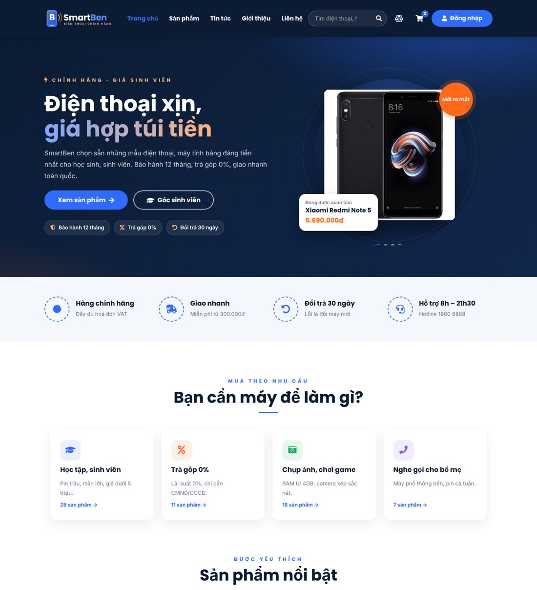
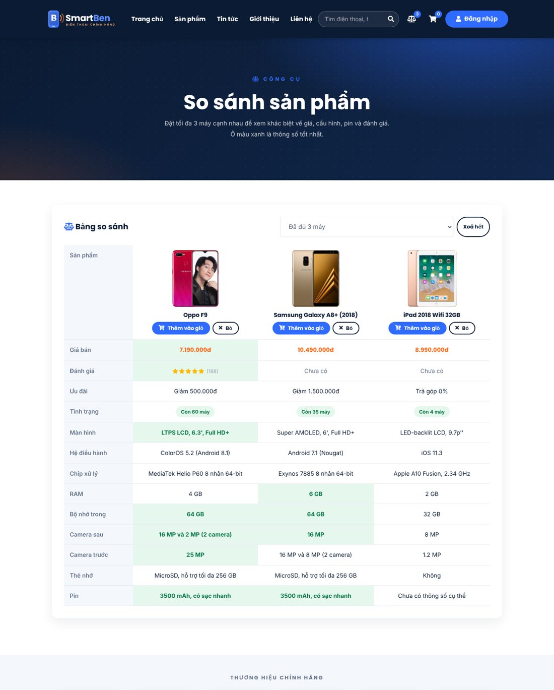
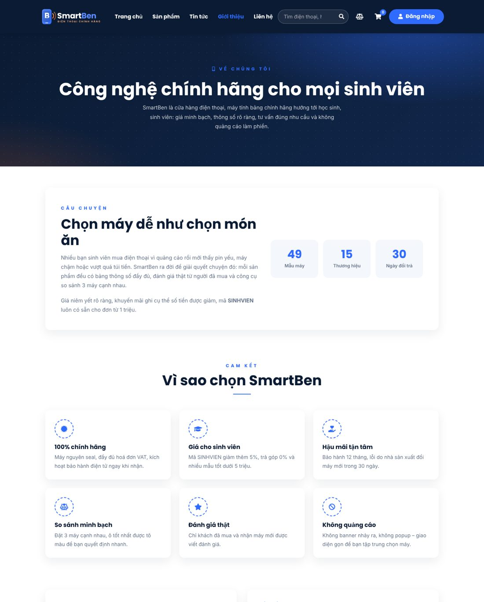
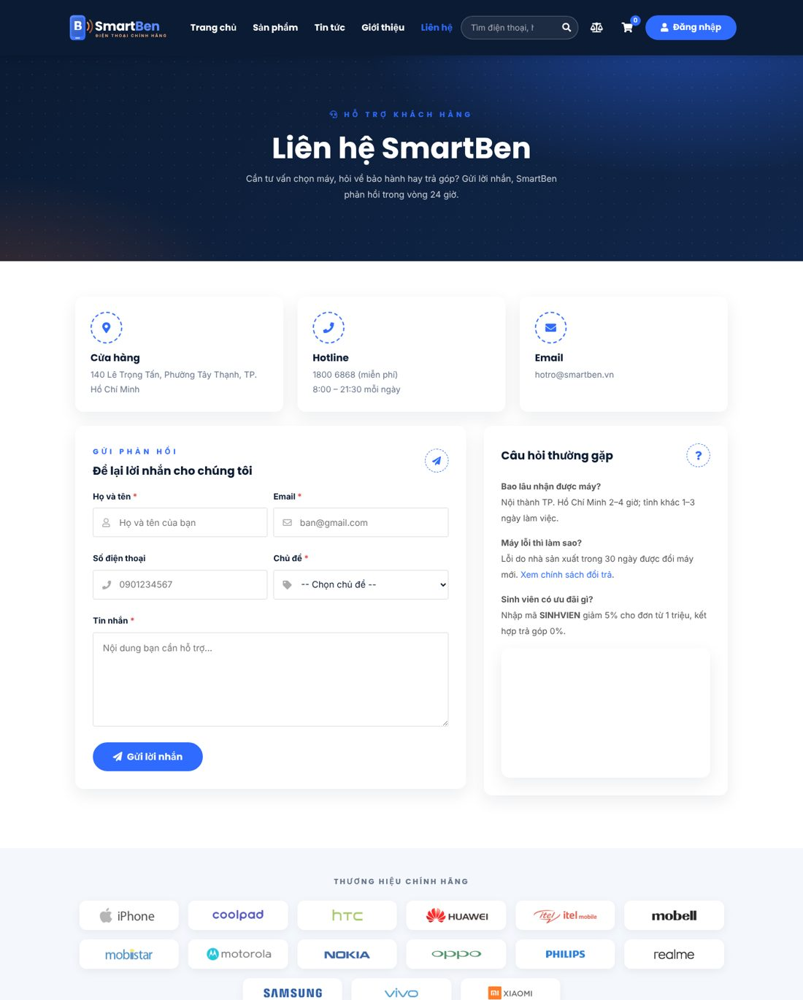

# 📱 SmartBen - Phone & Tablet E-commerce & Management Website

## 📌 Description

**SmartBen** is a phone and tablet e-commerce website designed for high school and university students. It offers a clean, ad-free interface where students can browse, compare and buy devices that fit their budget and needs (study, gaming, photography, installment payment, basic phones).

The system allows users to filter products by brand, price, RAM and rating, compare up to three devices side by side, save favourites, manage a shopping cart, apply discount codes, pay by **Cash on Delivery (COD)** or **bank transfer via QR code**, and track their orders.

The project was built using **HTML5, CSS3, JavaScript (ES5+), jQuery and Bootstrap 4**, focusing on responsive design, user experience and front-end development best practices. It is a fully static website: **no server or database is required**.

The website also includes an **Admin Dashboard** that supports order management, product management, discount code management, customer management, review moderation, news management, contact handling and revenue reports.

## 🌐 Live Demo

**Website**
[https://giapchithanh06.github.io/SmartBen-Store-Management-System/](https://giapchithanh06.github.io/SmartBen-Store-Management-System/)

**GitHub Repository**
[https://github.com/giapchithanh06/SmartBen-Store-Management-System](https://github.com/giapchithanh06/SmartBen-Store-Management-System)

## 🔑 Demo Accounts

| Role | Email | Password |
|---|---|---|
| Admin | admin@smartben.vn | admin123 |
| Customer | minh.sv@gmail.com | 123456 |
| Customer | ha.tran@gmail.com | 123456 |
| Customer | bao.le@gmail.com | 123456 |

**Discount codes:** `SINHVIEN`, `SMARTBEN10`, `GIAM200K`

## 🚀 Features

### 👤 Customer Features

**Authentication**
- User Registration
- User Login
- Remember Me (keeps you signed in for 30 days)
- Logout
- Passwords hashed before being saved
- Account page: update profile, change password, view favourites

**Product Browsing**
- Home page with featured products, "Needs" shortcuts (study, installment, photography & gaming, basic phones), product strips (new arrivals, online deals, 0% installment, discounted, budget) and latest news
- Browse 49 phones and tablets from popular brands
- Search with suggestions for product and brand names
- Filter by brand, device type, price range, promotion, RAM, rating and stock status
- Sort products and pagination (12 products per page)
- Product detail page with image gallery, specification table, promotion box, ratings and similar products
- Add to favourites and compare buttons on every product card

**Product Comparison**
- Compare up to 3 devices side by side
- Specification table with the best value in each row highlighted
- Shareable comparison link
- Add compared devices to cart directly

**Shopping Cart**
- Add to cart or Buy now
- Update quantity (maximum 5 units per product, checked against stock)
- Remove products from cart
- Automatic subtotal calculation
- Free shipping progress bar

**Checkout & Orders**
- Recipient information form with validation
- Automatic shipping fee calculation
- Discount code support
- Payment by COD or bank transfer QR code (VietQR)
- Order success page with QR code for transfer payment
- Order history ("My Orders")
- Order detail page with status timeline
- Customers can cancel orders that have not been shipped

**Reviews**
- Only customers who have received the device can write a review
- One review per customer per product
- Star rating and written comment

**Content & Support**
- News list and news detail pages
- About page
- Contact page with contact form and Google Map
- Policy page (warranty, returns, shipping, payment)
- Custom 404 page

### 👨‍💼 Admin Features

**Dashboard**
- Statistic cards
- Revenue chart for the last 7 days
- Best-selling products
- Recent orders
- Low-stock products
- New customers

**Order Management**
- Filter orders by status
- Search by order code, customer name or phone number
- Quick status change: Pending → Shipping → Completed / Cancelled
- Order detail page
- Cancelling an order returns stock and restores discount code usage
- Confirm payment received for QR transfers

**Product Management**
- Filter by brand, device type, status and keyword
- Add new products with brand, type, promotion label and technical specifications
- Upload main image and gallery images
- Stop selling / resume selling
- Delete products

**Discount Code Management**
- Create and edit codes
- Enable / disable codes
- Delete codes

**Customer Management**
- Search by name, email or phone number
- Lock / unlock accounts
- Delete accounts

**Review Management**
- Show / hide reviews
- Delete reviews

**News Management**
- Search news by title
- Add and edit news (title, summary, content, image)
- Quick show / hide
- Delete news

**Contact Management**
- Mark messages as handled
- Delete messages

**Reports & Statistics**
- Revenue by product
- Revenue by brand
- Revenue by order status
- Export orders to CSV (opens in Excel)
- Restore sample data

## 📋 Business Rules

**Shipping fee**
- Ho Chi Minh City: 20,000 VND
- Other provinces: 35,000 VND
- **Free shipping** for orders from 300,000 VND

**Discount codes**
- Checked for: enabled/disabled status, usage limit, minimum order value
- Percentage discounts have a maximum discount amount

| Code | Discount | Maximum | Minimum order |
|---|---|---|---|
| `SINHVIEN` | 5% | 300,000 VND | 1,000,000 VND |
| `SMARTBEN10` | 10% | 500,000 VND | 3,000,000 VND |
| `GIAM200K` | 200,000 VND | - | 5,000,000 VND |

**Stock**
- Placing an order reduces stock and increases code usage
- Cancelling an order returns stock and restores code usage
- Maximum 5 units per product in one cart
- Products at or below the low-stock threshold (5 units) are flagged in admin

**Order status**

```
Pending → Shipping → Completed
```

- Orders can be cancelled while Pending or Shipping
- Completed COD orders are marked as paid

## 🛠️ Technologies Used

- HTML5
- CSS3 (CSS Variables, Grid, Flexbox)
- JavaScript (ES5)
- jQuery
- Bootstrap 4
- Font Awesome 5
- Google Fonts
- VietQR
- Google Maps
- LocalStorage
- SessionStorage

## ✨ Modern Techniques Applied

### 📱 Responsive Web Design
- Bootstrap Grid System
- Mobile-first approach
- Mobile filter panel that collapses on small screens
- Adaptive layouts for Mobile, Tablet and Desktop

### 🧩 Reusable Components
Header, footer, product cards, toast notifications and form validation are generated by JavaScript (`giao-dien.js`), so every page shares the same layout and only needs to be edited in one place.

### 🗂️ Layered JavaScript Structure
- **Data layer** (`kho-du-lieu.js`): read, add, update and delete data
- **Business layer** (`nghiep-vu.js`): cart, shipping, discounts, orders, accounts, reviews, comparison
- **UI layer** (`giao-dien.js`, `trang/*.js`, `admin/*.js`): page rendering and events

All business settings (shipping fee, free-shipping threshold, comparison limit, bank account for QR, hotline…) are kept in one `CAU_HINH` config block.

### 💾 Client-side Data Storage

**LocalStorage** is used to store:
- Products
- Customer accounts
- Orders
- Discount codes
- News
- Reviews
- Contact messages
- "Remember me" login, favourites and comparison list

**SessionStorage** is used to store:
- Current login session
- Notifications passed to the next page

Sample data is loaded automatically on the first visit.

### 💳 QR Code Payment
QR codes are generated with the VietQR service, including the bank account, amount and order code, so customers can scan and pay with any banking app.

## 🖼️ Screenshots

| Home page | Product comparison | About |
|---|---|---|
|  |  |  |

| Contact |
|---|
|  |

## 📂 Project Structure

```
SmartBen-Store-Management-System/
│
├── index.html                      # Home page
├── cua-hang.html                   # Shop: filter, sort, search, pagination
├── san-pham.html                   # Product details
├── so-sanh.html                    # Product comparison
├── gio-hang.html                   # Shopping cart
├── thanh-toan.html                 # Checkout
├── dat-hang-thanh-cong.html        # Order success
├── don-hang-cua-toi.html           # My orders
├── chi-tiet-don-hang.html          # Order detail
├── tai-khoan.html                  # Account: profile, password, favourites
├── dang-nhap.html                  # Login
├── dang-ky.html                    # Register
├── tin-tuc.html                    # News
├── tin-tuc-chi-tiet.html           # News detail
├── gioi-thieu.html                 # About
├── lien-he.html                    # Contact
├── chinh-sach.html                 # Policies (tabs)
├── 404.html                        # Page not found
│
├── admin/
│   ├── index.html                  # Dashboard
│   ├── don-hang.html               # Orders
│   ├── don-hang-chi-tiet.html      # Order details
│   ├── san-pham.html               # Products
│   ├── san-pham-form.html          # Add / edit product
│   ├── ma-giam-gia.html            # Discount codes
│   ├── ma-giam-gia-form.html       # Add / edit discount code
│   ├── khach-hang.html             # Customers
│   ├── danh-gia.html               # Reviews
│   ├── tin-tuc.html                # News
│   ├── tin-tuc-form.html           # Add / edit news
│   ├── lien-he.html                # Contact messages
│   └── bao-cao.html                # Revenue reports
│
├── screenshots/                    # Screenshots for this README
│
└── assets/
    ├── css/
    │   ├── site.css                # Customer interface
    │   └── admin.css               # Admin interface
    ├── img/
    │   ├── products/               # Product images
    │   ├── hang/                   # Brand logos
    │   ├── tintuc/                 # News images
    │   └── logo-smartben.svg, favicon.svg
    └── js/
        ├── du-lieu-mau.js          # Sample data
        ├── kho-du-lieu.js          # LocalStorage data layer
        ├── nghiep-vu.js            # Business rules + CAU_HINH config
        ├── giao-dien.js            # Shared UI: header, footer, cards, toasts, validation
        ├── admin.js                # Admin layout + admin access control
        ├── trang/                  # Customer page scripts
        └── admin/                  # Admin page scripts
```

## 🎨 User Interface

The website interface was designed with:
- Modern phone-store style
- Blue & orange theme with a dark navy hero
- Responsive layout
- Hero banner with product slides
- Interactive product cards with promotion labels and quick actions
- Toast notifications
- Clean and user-friendly navigation
- Modern admin dashboard with sidebar menu

## ⚙️ System Architecture

```
HTML5
   ↓
CSS3 + Bootstrap 4
   ↓
JavaScript (UI → Business → Data)
   ↓
LocalStorage / SessionStorage
```

The project separates:
- User Interface
- Styling Components
- Business Logic
- Client-side Data Management

Benefits:
- Maintainability
- Scalability
- Code Reusability
- Better Project Organization

## ▶️ How to Run

**1. Clone the Repository**

```bash
git clone https://github.com/giapchithanh06/SmartBen-Store-Management-System.git
```

**2. Open the Project**

Recommended Tools:
- Visual Studio Code
- Any Modern Browser (Chrome, Edge, Firefox)

**3. Run the Website**

Open:

```
index.html
```

or

Use **Live Server** in VS Code for a better development experience.

> An Internet connection is needed for Google Fonts, Google Maps, QR codes and some product images. All other features work offline; product images that cannot load are replaced by a drawn placeholder.

**4. Open the Admin Dashboard**

Log in with the admin account above, or open:

```
admin/index.html
```

**Reset data:** Admin → **Báo cáo doanh thu** → **Khôi phục dữ liệu mẫu**

## 🔧 Quick Customization

| To change | Edit |
|---|---|
| Shipping fee, free-shipping threshold, comparison limit, QR bank account, hotline | `assets/js/nghiep-vu.js` → `CAU_HINH` |
| Menu, footer, contact information | `assets/js/giao-dien.js` → `veHeader()` / `veFooter()` |
| Admin menu | `assets/js/admin.js` |
| Colors, fonts, spacing | `assets/css/site.css` → `:root` |
| Logo | `assets/img/logo-smartben.svg` |
| Sample products, accounts, discount codes, news | `assets/js/du-lieu-mau.js` |

## 🎯 Purpose

This project was developed for educational purposes to practice:
- Front-end Web Development
- Responsive Web Design
- JavaScript Programming
- Bootstrap Framework
- E-commerce Website Development
- Admin Dashboard Development
- User Interface Design
- LocalStorage and SessionStorage Management

## 🚀 Future Improvements

- Database Integration
- RESTful API Development
- Secure server-side authentication
- Online Payment Gateway Integration
- Automatic payment confirmation
- Real-time Order Tracking
- Email order notifications
- Advanced Analytics Dashboard
- Customer Recommendation System

## 👨‍💻 Authors

**Giáp Chí Thanh**

Student Project – SmartBen Phone & Tablet E-commerce Website.

GitHub: [@giapchithanh06](https://github.com/giapchithanh06) · Email: chithanhgiap0409@gmail.com

## 📄 License

This project is intended for educational and learning purposes only.

All data is stored in the browser for demonstration purposes. No real payments are processed.
